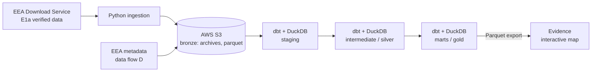
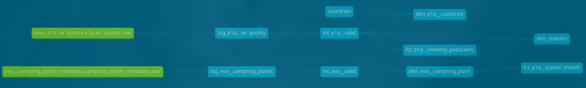
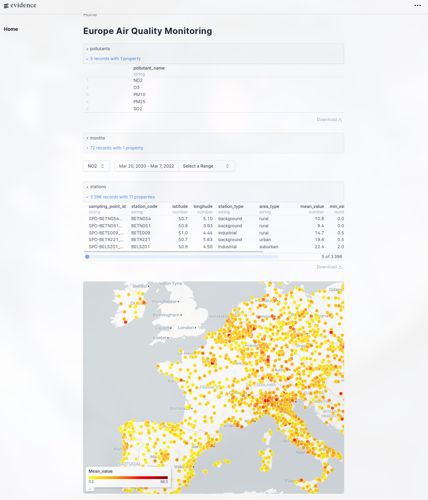

# European Air Quality ELT Pipeline

An on-demand batch ELT pipeline that ingests, validates, cleans and models European air quality measurements published by the European Environment Agency (EEA). The project focuses on data quality, reproducibility and clear modeling decisions rather than on heavy infrastructure.

> **Status: work in progress.** The core pipeline (ingestion → bronze → silver → gold) works end to end on the current scope. See [Status](#-status) and [Roadmap](#-roadmap).

## 📖 Overview

- **Scope:** hourly measurements of five pollutants (PM2.5, PM10, NO2, O3, SO2) for 37 European countries, January 2020 to December 2025, from the EEA verified dataset (E1a).
- **Scale:** +544 million hourly rows and around 190.000 sampling points.
- **Approach:** raw files are kept untouched in S3 (bronze); all cleaning decisions live in versioned SQL models (silver and gold) so they are visible, testable and reversible.
- **Stack:** Evidence Dev, Python, AWS S3, Parquet, DuckDB, dbt, managed with `uv`.
- **Output:** an interactive map of European monitoring stations colored by concentration, published as a static site built with Evidence.

## 📌 Status

| Area | State |
| --- | --- |
| Ingestion of EEA Parquet archives into S3 | ✅ Done |
| Sampling point metadata (EEA data flow D) | ✅ Done |
| dbt staging, intermediate and marts models | ✅ Done (growing) |
| dbt data tests | ✅ Basic coverage |
| Station dimension with coordinates | ✅ Done |
| Interactive station map (Evidence) | ✅ Done (local) |
| CI with GitHub Actions | ✅ Done |
| Makefile task runner | ✅ Done |
| Map deployment as a static site | 📝 Planned |
| Recent unverified data (E2a) and orchestration | 📝 Optional |

## 🏗️ Architecture



| Layer | Where | What happens |
| --- | --- | --- |
| **Bronze** | S3 (`raw/eea/`) | Files exactly as delivered by the EEA (ZIP archives and extracted Parquet), plus metadata. Never modified. |
| **Staging** | dbt (DuckDB) | One model per source. Renaming, typing, nothing else. |
| **Silver** (intermediate) | dbt (DuckDB) | Decisions: validity filtering, sentinel handling, quality flags, deduplication. |
| **Gold** (marts) | dbt (DuckDB) | Analysis-ready tables: dimensions and facts. |

### DBT Lineage Graph:


## ⚙️ How it works

### 1. Source data

The EEA Air Quality Download Service delivers ZIP archives of Parquet files for a requested country, pollutant and period. Two datasets exist:

- **E1a:** verified data, reported by countries after validation. This is what the project uses.
- **E2a:** recent, not yet verified data. Not implemented yet.

Each measurement carries a `Validity` flag (is the value usable?) and a `Verification` status (has it been checked?). Sampling point coordinates are not in the measurement files: they come from the EEA metadata (data flow D, reported yearly by countries).

### 2. Ingestion (bronze)

Implemented in `src/air_quality_pipeline/bronze/ingestion/`.

1. For one `(country, pollutant, period)`, a request is sent to the EEA download API.
2. The response is checked to be a valid ZIP archive.
3. The archive is uploaded as-is to S3 (`archives/`).
4. The Parquet files inside are extracted and uploaded to S3 (`parquet/`) under Hive-style partitions.

**Why this design**

- Object keys are built from the request parameters, so rerunning the same request overwrites the same objects instead of creating duplicates.
- Keeping the original ZIP files allows auditing and replaying the extraction without downloading again.
- Partitions such as `country=FR/pollutant_name=PM25/year=2020/month=01` are understood by DuckDB, which then only reads the files it needs.

### 3. S3 layout

```text
s3://aws-s3-air-quality-bucket/
└── raw/
    └── eea/
        ├── archives/        # original ZIP files, by country / pollutant / year
        ├── metadata/        # sampling point metadata (EEA data flow D, CSV)
        └── parquet/         # extracted Parquet files, Hive-style partitions
            └── country=FR/
                └── pollutant_name=PM25/
                    └── year=2020/
                        └── month=01/
                            └── ...parquet
```

### 4. Staging

One model per source, only changing the *form* of the data:

- snake_case column names and explicit type casts;
- partition columns (`country`, `pollutant_name`, `year`, `month`) read from the S3 path;
- no filtering, so invalid rows can still be counted and analyzed.

DuckDB reads the Parquet files directly from S3 through the `httpfs` extension and a temporary S3 secret created from environment variables, so no credentials are written in the repository.

### 5. Intermediate (silver)

This is where decisions are made.

| Rule | Why |
| --- | --- |
| Normalize sampling point IDs by removing the country prefix (`FR/SPO-...` → `SPO-...`) | Measurement files and metadata do not use the same ID format; this is the join key. |
| Keep validity codes `1`, `2`, `3`; drop `-99` and `-1` | `1` valid; `2` valid but below detection limit (value given); `3` valid but below detection limit (value replaced by half the limit). `-99` invalid because of maintenance/calibration; `-1` invalid for other reasons. |
| Turn the sentinel value `-999` into `NULL` | `-999` means "no measurement"; leaving it would corrupt every average. |
| Flag instead of delete: `is_below_detection_limit`, `is_imputed`, `is_negative` | Small negative values are normal instrument noise; the decision to exclude them belongs to downstream models. |
| Deduplicate on `(sampling point, pollutant, period start, period end)`, keeping the best verification status and the most recent result | A measurement must appear once. |

### 6. Marts (gold)

- **`dim_eea__sampling_point`:** one row per sampling point, built from the latest declaration in the EEA metadata (coordinates, station type, area type).
- **Analytical marts:** an initial mart linking countries to their number of monitoring stations. More marts are added as the scope grows.

Data tests (`not_null`, `unique`, `relationships`, and more) are declared in the YAML files next to the models and run with `dbt build`.

### 7. Map (Evidence)

The gold mart `mart_station_info` is exported by dbt as a Parquet file into `evidence-legacy/sources/air_quality/`. Evidence loads it with `npm run sources` and the page `pages/index.md` queries it in SQL and draws the stations on an OpenStreetMap basemap, colored by concentration.

**Why this design**

- The map is a static site: no server and no credentials in the browser.
- Evidence Studio (the current hosted version) cannot read local Parquet files, so this project uses the open-source version of Evidence with a Parquet connector.
- Only a small aggregated mart is shipped to the browser, never hourly data.

#### First look at the map on Evidence



### 8. Large-volume builds (incremental by country and year)

The bronze layer holds all European countries, which is too much to process in a single query on one machine. The heavy hourly model (`int_e1a__valid`) is incremental and processed one **slice** (country and year) at a time:

- the slice is chosen with dbt variables (`--vars "{country: 'FR', year: 2023}"`);
- DuckDB pushes the filter down to the Parquet files, so only the matching S3 partitions are read;
- each slice is tagged with a `batch_key` (for example `FR-2023`); rerunning a slice replaces exactly that slice, so runs are idempotent;
- dimensions, facts and marts are cheap aggregates and remain regular tables.

Assumption: duplicates never span two slices, which holds for E1a because requests are non-overlapping calendar months.

## ✅ Data quality

- With the current metadata, every sampling point present in the measurements has coordinates (checked in `dim_stations`).
- Quality decisions are kept visible: flags rather than silent deletion, tests rather than assumptions.
- An earlier metadata snapshot (from 2020) was replaced by the EEA data flow D metadata after a per-year match check showed the older file was missing recent sampling points.

## 🧠 Design decisions

| Decision | Reason |
| --- | --- |
| **DuckDB instead of Spark / Databricks** | The data fits on a single machine. DuckDB reads Parquet from S3 directly and handles tens of millions of rows. A cluster would add cost and complexity without a benefit at this scale. |
| **S3 + Parquet** | Cheap, standard, separates storage from compute, and keeps raw data immutable. |
| **dbt for transformations** | Dependency-aware SQL models, tests, documentation and lineage. |
| **Flags instead of deleting rows** | Filtering is a decision; making it in a later model keeps the earlier data inspectable. |
| **Metadata as a source, not a dbt seed** | It is large and changes over time; seeds are meant for small static files. |
| **`uv` for Python dependencies** | Fast, reproducible environments from `pyproject.toml` and a lockfile. |
| **Incremental only for the heavy hourly models** | Rebuilding hundreds of millions of rows at once exceeds the memory of a single machine; aggregates are cheap to rebuild, so keeping them as plain tables avoids drift. |
| **Makefile as task runner** | One command per task from the repository root, without remembering which folder to enter. |

## 📦 Project structure

```text
air-quality-pipeline/
├── README.md
├── pyproject.toml
├── uv.lock
├── src/
│   └── air_quality_pipeline/
│       └── bronze/                     # Ingestion and bronze layer
│           ├── ingestion/
│           │   ├── get_date.py         # Date helpers for ingestion windows
│           │   └── get_raw_data.py     # Download, validation, extraction and S3 upload
│           └── utils/
│               ├── config.py           # Pipeline and storage configuration
│               └── logging.py          # Logging setup for ingestion runs
│
├── dbt/                                # Silver and gold layers
│   ├── dbt_project.yml                 # dbt project configuration
│   ├── profiles.yml                    # dbt connection profile (gitignored)
│   ├── dev.duckdb                      # Local DuckDB database (gitignored)
│   ├── .env.example                    # Environment variables template (no secrets)
│   └── models/
│       ├── staging/
│       │   ├── E1a/                    # Staging models for E1a data
│       │   └── metadata/               # Metadata of EEA
│       ├── intermediate/
│       │   └── E1a/                    # Validity rules, flags, deduplication
│       │   └── metadata/
│       └── marts/
│           ├── E1a/                    # Dimensions and facts for E1a data
│           └── metadata/
│
└── evidence-legacy/                    # Interactive map (open-source Evidence)
    ├── pages/
    │   └── index.md                    # Map page (SQL + components)
    ├── sources/
    │   └── air_quality/
    │       ├── connection.yaml         # Parquet connector configuration
    │       └── *.parquet               # Gold marts exported by dbt
    ├── evidence.config.yaml            # Project settings
    ├── evidence.plugins.yaml           # Registered plugins (Parquet connector)
    ├── theme.yaml                      # Site theme
    ├── access.yaml                     # Template file (unused)
    ├── package.json
    └── package-lock.json               # Pinned Node dependencies
```

## 🚀 Getting started

### Prerequisites

- [uv](https://docs.astral.sh/uv/) (it installs and manages the Python version and dependencies)
- An AWS account with an S3 bucket and credentials allowed to list, read and write it
- No EEA account or API key is needed

### Evidence (map)

- Node.js 20 (installed with [nvm](https://github.com/nvm-sh/nvm)); other major versions may not work with this Evidence version
- npm 7+ and Git

### Installation

```bash
git clone https://github.com/gwen-mp4/europe-air-quality.git
cd europe-air-quality

# Python environment
uv sync

# Evidence
nvm install 20 && nvm use 20
cd evidence-legacy && npm install && cd ..
```

### Configuration

```bash
# 1. Copy the templates
cp dbt/.env.example dbt/.env
cp dbt/profiles.yml.example dbt/profiles.yml

# 2. Fill in dbt/.env (AWS region, bucket, credentials), then load it into your shell
set -a && source dbt/.env && set +a
```

dbt does **not** load `.env` files by itself. `profiles.yml` reads the variables with `env_var(...)`, so they must exist in your shell.
```

dbt does **not** read `.env` files by itself. You have to write down the variables in `profiles.yml` (located in `~/.dbt/profiles.yml` by default on Linux) using Jinja templates:  
```bash
secrets:
- type: s3
    region: "{{ env_var('S3_REGION') }}"
    key_id: "{{ env_var('S3_ACCESS_KEY_ID') }}"
    secret: "{{ env_var('S3_SECRET_ACCESS_KEY') }}"
```

### Running tasks with `make`

All commands run from the repository root. Run `make help` to list them.

| Command | What it does |
| --- | --- |
| `make install` | Install Python and Node dependencies |
| `make ingest` | Download EEA data into S3 (see src/air_quality_pipeline/bronze/utils/config.py for more info of what are downloaded) |
| `make dbt-batches COUNTRIES="FR" YEARS="2024 2025"` | Build the heavy hourly models one country/year slice at a time |
| `make dbt-rest` | Build dimensions, facts and marts |
| `make dbt-test` | Run all dbt tests |
| `make transform` | `dbt-batches` + `dbt-rest` + `dbt-test` |
| `make map-sources` / `make map-dev` / `make map-build` | Load data into Evidence, run the map locally, build the static site |
| `make refresh` | Ingest, transform and reload the map |

### Run the ingestion

By default, the program fetches data from January 2020 to December 2025, from all EEA member countries and for PM2.5, PM10, NO2, O3 and SO2 pollutants.

But you can also change the arguments (date, countries and pollutants) in `src/air_quality_pipeline/bronze/utils/config.py`.  

```bash
uv run python -m src.air_quality_pipeline.bronze.ingestion.get_raw_data
```

### Run the transformations

```bash
cd dbt

# Check the connection and the profile
uv run dbt debug --profiles-dir .

# Build everything (models + tests)
uv run dbt build --profiles-dir .
```

On the first run, build step by step to read errors more easily:

```bash
uv run dbt build --select stg_e1a__air_quality --profiles-dir .
uv run dbt build --select +int_e1a__valid --profiles-dir .
```

`+model` selects a model and everything it depends on; `model+` selects it and everything downstream.

### Build and view the map

```bash
# 1. Rebuild the mart exported to Evidence
cd dbt
uv run dbt build --select mart_station_info --profiles-dir .

# 2. Load it into Evidence and start the site
cd ../evidence-legacy
npm run sources         # needs sources/air_quality/connection.yaml
npm run dev             # http://localhost:3000
```

## 🛠️ Useful commands

```bash
# List what is stored in S3 and its total size (needs AWS CLI installed and logged via 'aws login')
aws s3 ls s3://{your_bucket_name}/raw/eea/ --recursive --human-readable --summarize

# Generate and open the dbt documentation (includes the lineage graph)
uv run dbt docs generate --profiles-dir .
uv run dbt docs serve --profiles-dir .

# Inspect the local DuckDB database (read-only, avoids lock conflicts, by default, database name is dev.duckdb)
uv run python -c "import duckdb; duckdb.connect('dev.duckdb', read_only=True).sql('show all tables').show()"
```

## 🩺 Troubleshooting

| Problem | Likely cause and fix |
| --- | --- |
| `dbt debug` cannot find the profile | Run it from the `dbt/` folder with `--profiles-dir .`, and check that the profile name in `profiles.yml` matches `profile:` in `dbt_project.yml`. |
| `Env var required but not provided` | The variables from `.env` were not exported. See [Configuration](#configuration). |
| S3 errors (`403`, `Access Denied`, region errors) | Check the credentials, that the secret region matches the bucket region (eu-west-3), and that the IAM user can list, read and write the bucket. |
| `Could not set lock on file` / `database is locked` | Another process (DuckDB CLI, notebook, IDE extension) has `dev.duckdb` open. Close it or open the database read-only. |
| Out-of-memory errors or the editor freezes on large models | Set `memory_limit`, `temp_directory` and `threads` in the DuckDB settings of the dbt profile, materialize upstream models as tables, and avoid `select *` before window functions. |
| Sampling points do not match the metadata | Check the ID normalization (country prefix) and compare match rates per country before writing any new rule. |
| EEA download returns an error or a non-ZIP response | Temporary service issue or wrong parameters. The request is safe to rerun. |
| First `dbt build` is slow | DuckDB reads Parquet from S3 for the first time. Later models read local tables. |
| `dbt run` fails with "Required var 'country' not found" | The heavy models need `--vars "{country: 'FR', year: 2023}"`. Use `make dbt-batches`. |
| Out-of-memory even with one slice | Lower `threads`, set `memory_limit` and `temp_directory` in the dbt profile, or split the slice further. |
| Country `NO` is treated as `false` | Quote country codes in `--vars`: `{country: 'NO'}`. |
| `npm run sources` fails or the source is unknown | `sources/air_quality/connection.yaml` is missing. Recreate it from `http://localhost:3000/settings` (new source with the Parquet connector). |
| Evidence will not install or start | Use Node.js 20 (`nvm use 20`). |
| `JavaScript heap out of memory` during `npm run sources` | Keep the exported mart small, or run `NODE_OPTIONS="--max-old-space-size=4096" npm run sources`. |
| Table `air_quality.mart_station_info` not found | The source name is the folder name and the table name is the file name. Rerun `npm run sources`. |
| The map is blank | The basemap tiles need an internet connection. |

## ⚠️ Known limitations

- Only verified (E1a) data is processed; recent unverified data is not.
- Timestamps follow the time zone of each reporting network, which matters when aggregating by day.
- The map uses the open-source version of Evidence, which receives no new features.
- Single-machine processing: DuckDB memory and temporary directory settings matter at this scale.

## 🗺️ Roadmap

1. Deploy the map as a static site (GitHub Pages) and add a live demo link.
2. CI with GitHub Actions: lint, tests and `dbt build` on a small sample.
3. Time-series views (monthly facts by country) in the Evidence app.
4. Additional data quality reporting from dbt tests.
5. *(Optional)* Recent unverified data (E2a) with scheduled collection, and orchestration.

## 🤝 Credits

- **Data:** European Environment Agency (EEA). Please refer to the EEA copyright and reuse policy.
- **Tools:** Evidence Dev, AWS S3, DuckDB, dbt, Python and uv.
- **Map tiles**: © OpenStreetMap contributors © CARTO
